<div align="center">

# Hexapod CPG · Bio-inspired Locomotion on a Custom 18-DoF Robot

**A four-person team's field hexapod and its locomotion study — mechanical CAD (chassis derived from Mark W's open-source skeleton), autonomous Arduino-Mega firmware with closed-loop IMU heading hold (extended from Mark W's original), and a Python central-pattern-generator simulation built on six Kuramoto-coupled phase oscillators where wave / ripple / tripod gaits arise from a single parameter. The CPG runs in simulation only; the fielded robot walked under the Arduino firmware. See [Attribution](#attribution).**

[](https://github.com/Janga786/hexapod-cpg/actions/workflows/ci.yml)
[](https://www.python.org/downloads/)
[](firmware/)
[](LICENSE)
[](https://github.com/astral-sh/ruff)
[](#testing)
[](CITATION.cff)

<br/>

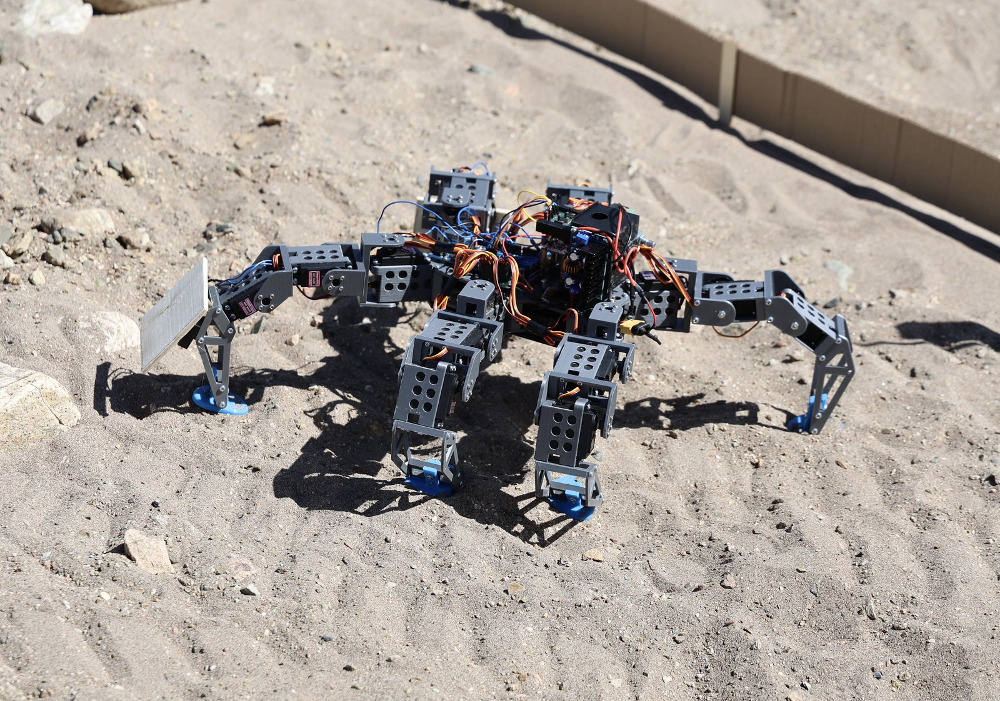

<br/>
<sub>The hexapod, fielded at the Great Sand Dunes for a robotics challenge.  18-DoF body, fully 3-D-printed chassis, autonomous Arduino-Mega firmware with closed-loop IMU heading hold and bump-avoidance.</sub>

<br/><br/>

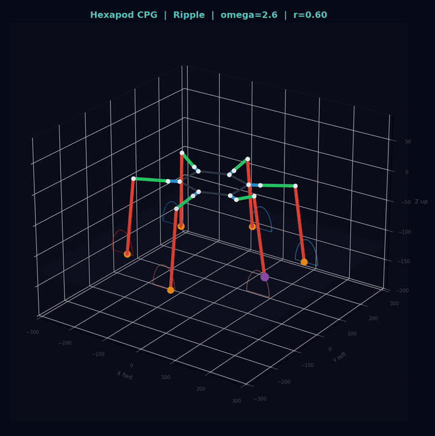

<br/>
<sub>The CPG simulator dashboard — left: 3-D body and per-leg foot trails; top right: the phase wheel; middle right: a rolling gait diagram; bottom right: a live status panel.  All four panels are driven from one ``FuncAnimation`` loop at 30 fps.</sub>

</div>

---

## Contents

- [Overview](#overview)
- [Highlights](#highlights)
- [The robot in the field](#the-robot-in-the-field)
- [Simulator gallery](#simulator-gallery)
- [Mathematical foundations](#mathematical-foundations)
- [Repository layout](#repository-layout)
- [Quick start](#quick-start)
- [Reproducing every figure & animation](#reproducing-every-figure--animation)
- [Firmware overview](#firmware-overview)
- [Hardware overview](#hardware-overview)
- [Testing](#testing)
- [Roadmap](#roadmap)
- [References](#references)
- [Citation](#citation)
- [License](#license)

---

## Overview

This repository documents the hexapod our four-person Fort Lewis College
team built and fielded for the NASA-sponsored Colorado Robotics Challenge
(I led the team): a fully 3-D-printed chassis (~75 printed parts, all
included as STL; the skeleton derives from Mark W's open-source design),
an Arduino-Mega-2560 firmware stack with closed-loop IMU heading
hold + bump-avoidance + scripted performance routines (extended from
Mark W's original firmware), and a Python central-pattern-generator (CPG)
simulation that turns a network of six coupled Kuramoto oscillators into
smooth, gait-correct locomotion. The CPG is a post-challenge simulation
study; it has not driven the physical robot.

The interesting bit is the CPG: rather than storing the wave / ripple /
tripod gaits as separate hard-coded tables, the simulation produces all
three from **one oscillator network** as a single parameter — the
natural-frequency drive ω — is varied (the inter-leg phase targets blend
between designed wave and tripod offset matrices; the synchronization
onto those targets is what the dynamics provide).  Watch a phase wheel collapse
from random initial conditions into the tripod attractor and you get
an unusually clean intuition for why bio-inspired locomotion
controllers work.

> **Why this matters.** Hexapod gait is usually presented as a fixed
> set of phase tables (\"five down, one up\" for wave; \"three down,
> three up\" for tripod).  This project shows that *all* three
> patterns are stable attractors of the *same* coupled-oscillator
> network — the gait you observe is a continuous function of ω, and
> the transition between gaits is something the CPG handles for free.

---

## Highlights

| Capability | Implementation | Verified to |
| :--- | :--- | :--- |
| 6-oscillator Kuramoto CPG with smooth wave⇄tripod blending | `hexapod_cpg.cpg.CPGNetwork` | high-ω locks to coherence > 0.85 in < 5 s; survives π perturbation kicks |
| 18-DoF analytical inverse kinematics with reach + servo-limit checks | `hexapod_cpg.geometry.ik` | round-trip IK→FK exact at neutral pose for every leg |
| Foot-trajectory generator (cosine stance, smoothstep swing, sin-arc lift) | `hexapod_cpg.cpg.CPGNetwork._feet_from_phases` | ω-dependent duty factor, 0.62–0.70 over ω = 1–5 (clamped to 0.50–0.72) |
| Real-time 4-panel matplotlib dashboard (3-D, phase wheel, gait diagram, status) | `hexapod_cpg.viz.CPGViz` | 30 fps on a stock laptop |
| **Closed-loop IMU heading hold** (P + complementary filter) on the real robot | `firmware/hexapod_full/` | gyro-bias auto-cal + mag fusion; field-tunable `K_p` and `α` in `config.h` |
| Bump-avoidance state machine (walk → backup → turn → walk) | `firmware/hexapod_full/` | 1.5 s debounce, ramped speed transitions |
| 6 scripted performance routines (wave, sway, pump, twist, stomp, full) | `firmware/hexapod_full/` | open-loop time-varying foot-position offsets |
| Programmatic CAD bill-of-materials (≈75 printed parts) | `hardware/cad/`              | STL + SolidWorks + STEP + Fusion archive |

**34 pytest tests** running on every push across Python 3.10/3.11/3.12 on Ubuntu and macOS via GitHub Actions. The suite is < 1 s wall-clock.

---

## The robot in the field

<table>
<tr>
<td align="center" width="50%">
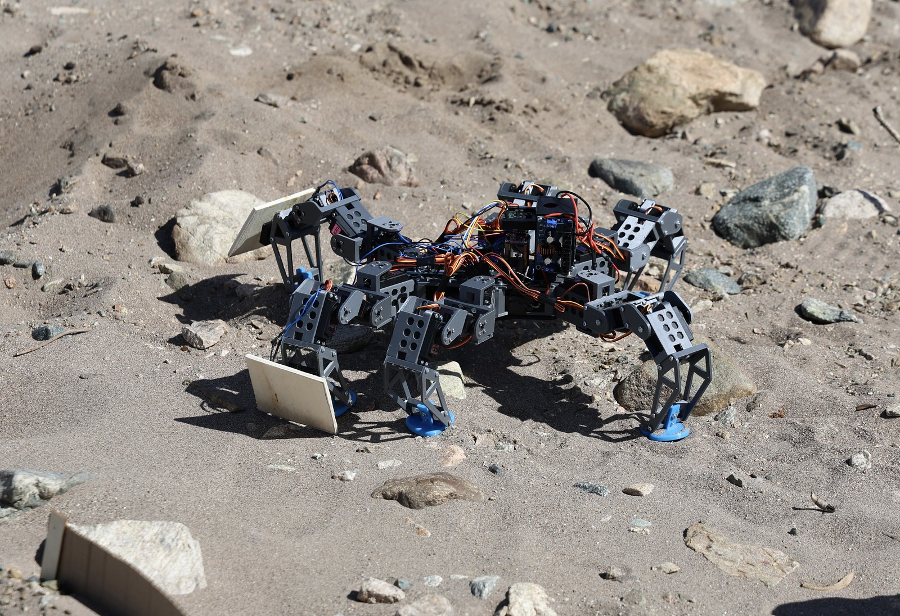<br/>
<sub><b>In motion.</b>  The robot navigating loose sand and small rocks; the front-mounted cardboard panels are field-added obstacle-clearing flippers used during the challenge.</sub>
</td>
<td align="center" width="50%">
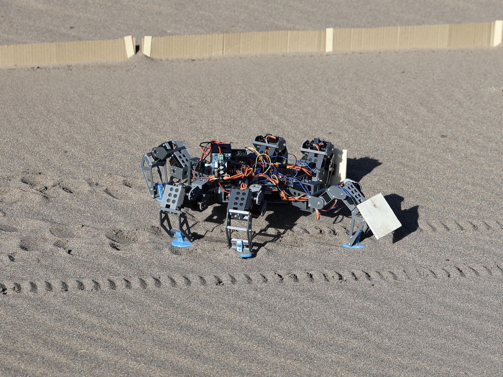<br/>
<sub><b>After a run.</b>  Three-quarter rear view showing the gait pattern in the foot tracks left in the sand — the alternating pairs are the tripod groups marching across the surface.</sub>
</td>
</tr>
<tr>
<td align="center" colspan="2">
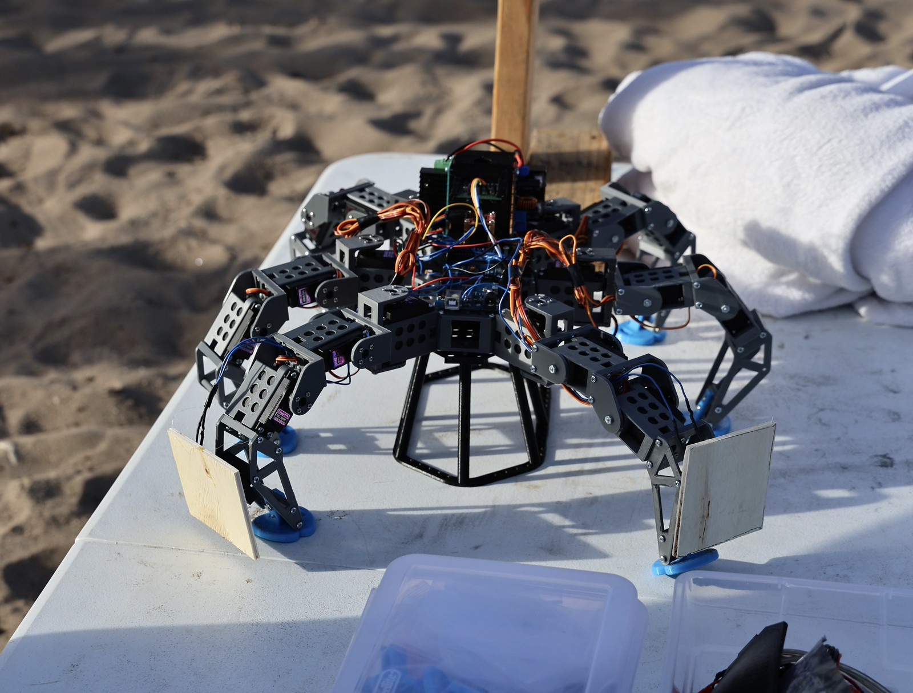<br/>
<sub><b>Mechanism detail.</b>  Side view on the workbench between runs.  Three servos per leg (coxa / femur / tibia), one Arduino Mega + IMU on top, blue TPU foot bumpers for sensor-friendly ground contact.</sub>
</td>
</tr>
</table>

---

## Simulator gallery

<table>
<tr>
<td align="center" width="50%">
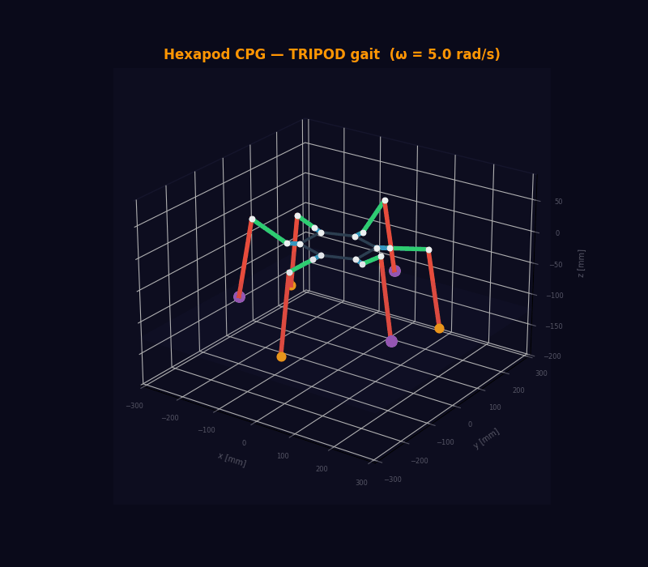<br/>
<sub><b>Tripod gait.</b>  ω = 5.0 rad/s.  Two anti-phase groups of three legs alternate; this is the textbook fast hexapod gait.</sub>
</td>
<td align="center" width="50%">
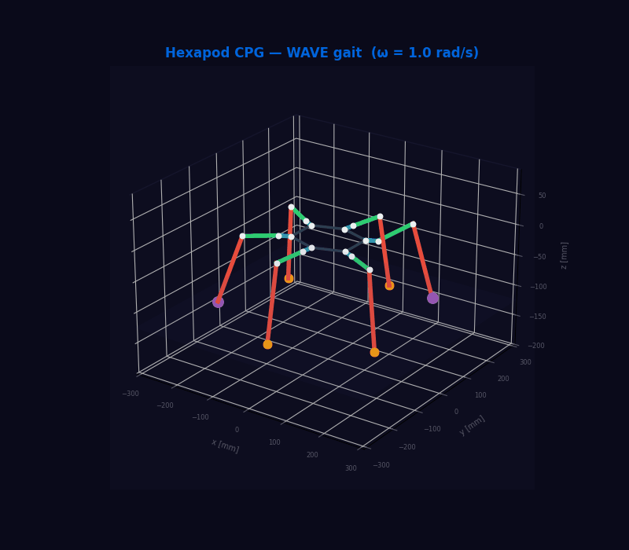<br/>
<sub><b>Wave gait.</b>  ω = 1.0 rad/s.  60° front-to-back propagation at a high duty factor (β ≈ 0.70 — roughly four legs in stance at any moment).</sub>
</td>
</tr>
<tr>
<td align="center">
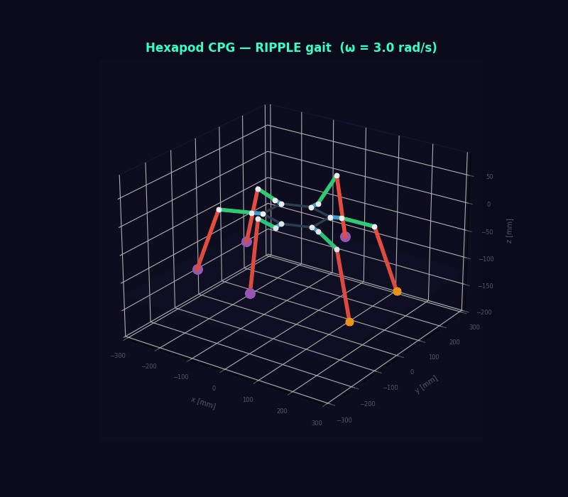<br/>
<sub><b>Ripple gait.</b>  ω = 3.0 rad/s.  An emergent intermediate; four legs in stance, two in swing, distributed.</sub>
</td>
<td align="center">
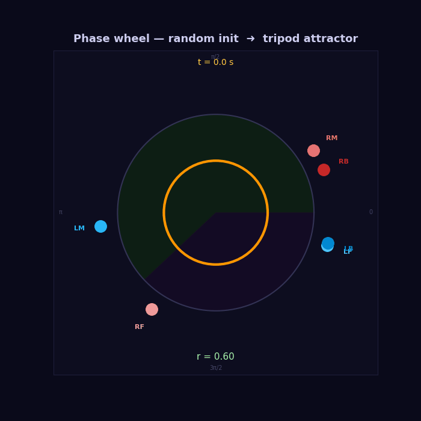<br/>
<sub><b>Phase-wheel lock-in.</b>  Six dots on the unit circle, scattered at t = 0, collapse into the tripod attractor by t ≈ 3 s — emergence in motion.</sub>
</td>
</tr>
</table>

<table>
<tr>
<td align="center" width="33%">
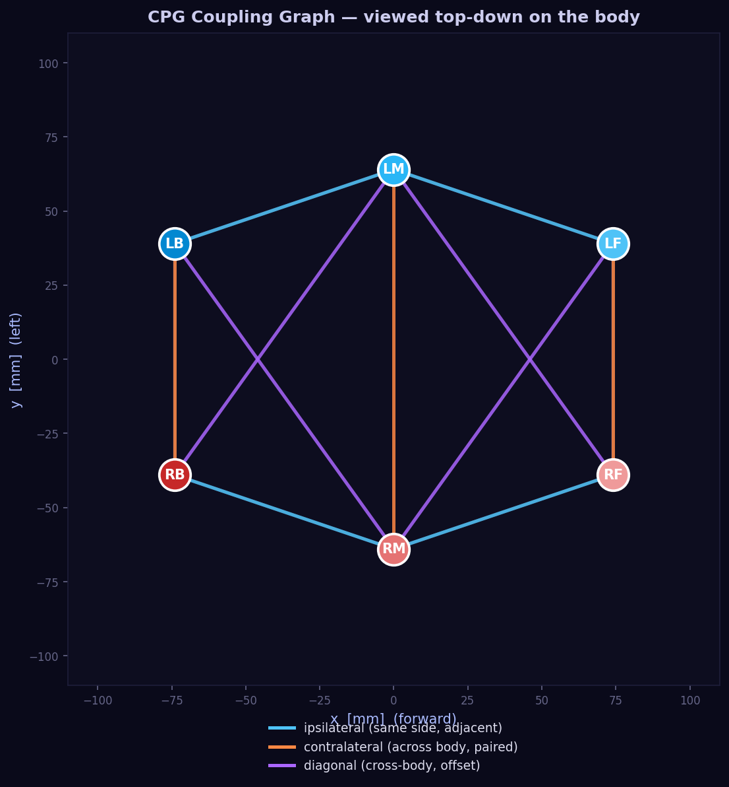<br/>
<sub><b>Coupling graph.</b>  Top-down view of the body with ipsilateral / contralateral / diagonal CPG edges.</sub>
</td>
<td align="center" width="33%">
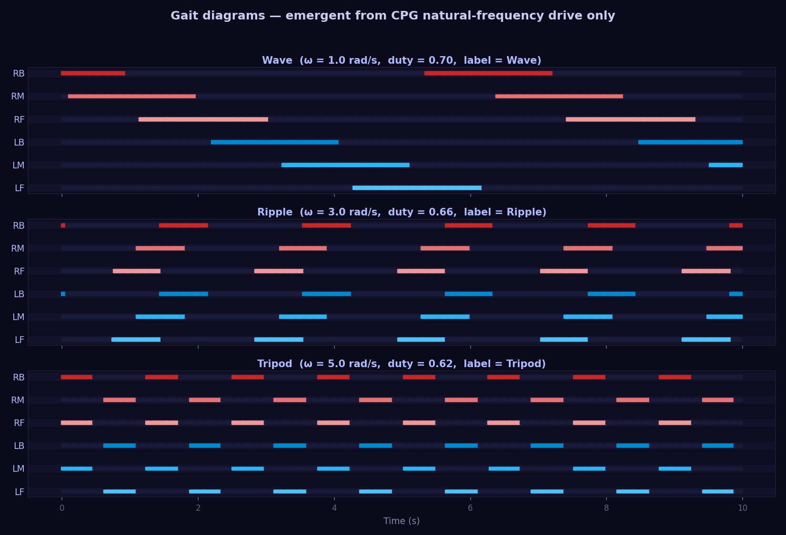<br/>
<sub><b>Gait diagrams.</b>  Stance/swing patterns at ω = 1, 3, 5 rad/s.  Wave / ripple / tripod emerge from <em>the same</em> CPG.</sub>
</td>
<td align="center" width="33%">
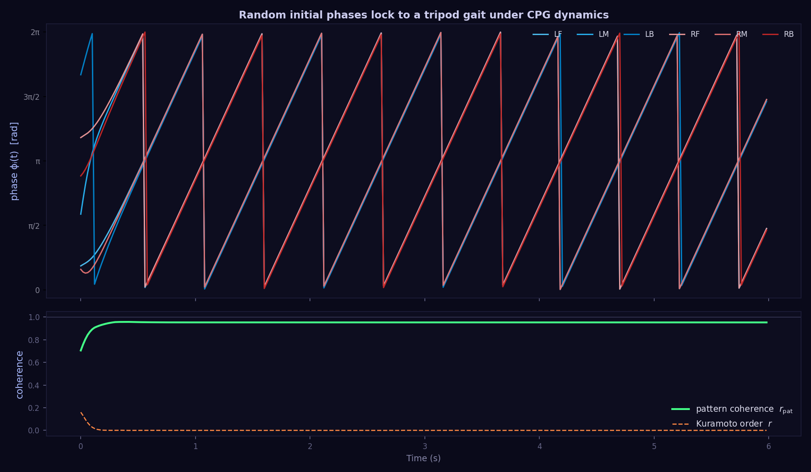<br/>
<sub><b>Convergence.</b>  Random initial phases lock into a tripod gait; pattern coherence (green) climbs to 1, while the global Kuramoto order (orange) misleadingly stays low — antiphase tripod groups average out.</sub>
</td>
</tr>
<tr>
<td align="center">
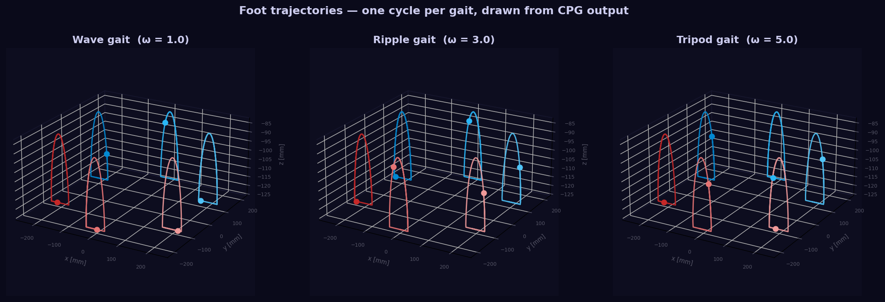<br/>
<sub><b>Foot trajectories.</b>  One full cycle of (x, y, z) foot path per leg, rendered for each gait; the smoothstep swing arc and the cosine stance segment are directly visible.</sub>
</td>
<td align="center">
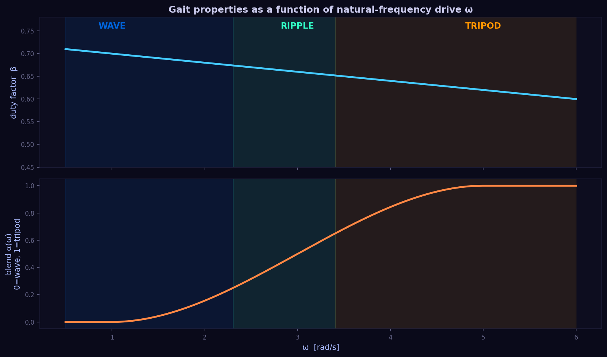<br/>
<sub><b>ω-sweep.</b>  Duty factor and the smoothstep blend coefficient α(ω) over the entire operating range, with gait labels coloured.</sub>
</td>
<td align="center">
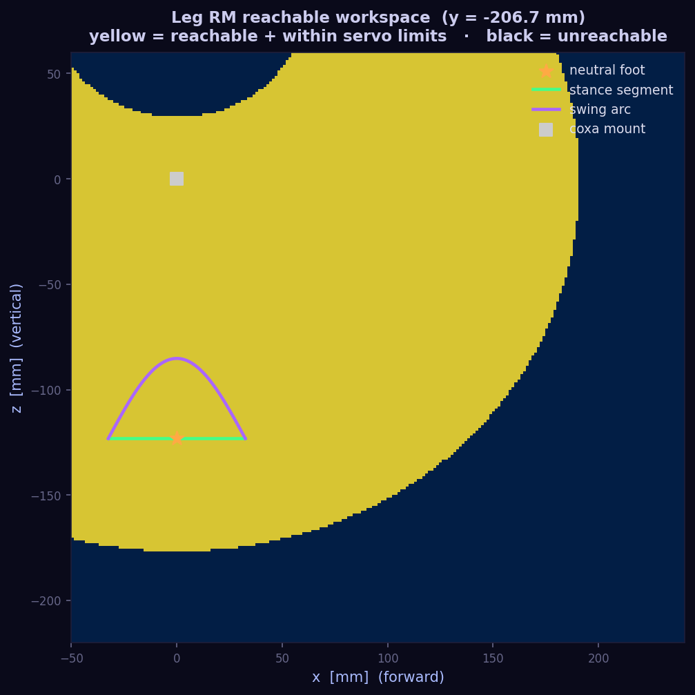<br/>
<sub><b>Leg workspace.</b>  Reachable region in the (x, z) plane for one leg, with the neutral foot, the stance segment and the swing arc overlaid.</sub>
</td>
</tr>
</table>

---

## Mathematical foundations

> The whole controller pipeline collapses to three layered ideas; skip if familiar.

### 1. Kuramoto coupled-oscillator network

Each leg is one phase oscillator $\varphi_i \in [0, 2\pi)$ and the six are
coupled by a directed graph that encodes ipsilateral, contralateral, and
diagonal interactions:

$$
\dot{\varphi_i} = \omega + \sum_{j} K_{ij}\,\sin(\varphi_j - \varphi_i - \theta_{ij}(\omega)) + \eta_i
$$

with $\eta_i \sim \mathcal{N}(0, \sigma)$ a small phase noise injection so the
emergence remains visible from random initial conditions.

The phase-offset matrix $\theta_{ij}(\omega)$ smoothly interpolates between
two target patterns:

- $\theta^{\mathrm{wave}}$ — even 60° spacing front-to-back
  (LF=0°, LM=60°, LB=120°, RF=180°, RM=240°, RB=300°);
- $\theta^{\mathrm{tripod}}$ — two anti-phase groups
  (group A: LF, LB, RM at 0°; group B: RF, LM, RB at 180°).

The blend coefficient is $\alpha(\omega) = \mathrm{smoothstep}((\omega - 1) / 4)$, giving a
wave gait at low $\omega$ and a tripod gait at high $\omega$, with
ripple-like patterns in between.

Integration is **explicit midpoint (RK2)** at the visualiser frame rate
($\sim 30 \mathrm{Hz}$); stable for the coupling strengths in use and substantially
more accurate than forward Euler at the same cost.

### 2. Foot trajectory generator

Phase $\varphi_i$ partitions the cycle into a *stance* segment of duration
$\beta\,T$ (where $\beta$ is the duty factor and $T = 2\pi / \omega$) and a
*swing* segment of duration $(1-\beta)T$:

$$
\mathbf p_i(\varphi_i) =
\begin{cases}
\mathbf p^{\mathrm{neutral}}_i + \mathbf s_i\,(\tfrac{1}{2} - t_{\mathrm{st}}) & \text{(stance)} \\
\mathbf p^{\mathrm{neutral}}_i + \mathbf s_i\,(\mathrm{smoothstep}(t_{\mathrm{sw}}) - \tfrac{1}{2}) + h\,\sin(\pi t_{\mathrm{sw}})\,\hat z & \text{(swing)}
\end{cases}
$$

The duty factor itself decreases with $\omega$, modelling the empirical
observation that fast hexapods spend less time on each foot —
$\beta(\omega) = \mathrm{clamp}(0.70 - 0.08(\omega - 1)/4,\ 0.50,\ 0.72)$.

The stride vector $\mathbf s_i$ blends a translational component (set by the
walk direction) with a rotational component (tangent to the leg's mount
radius), so a single CPG drives both linear and angular locomotion.

### 3. Closed-form 3-DoF leg kinematics

For a target foot position $\mathbf p = (x, y, z)$ in the body frame and a
coxa-mount at $(m_x, m_y)$:

$$
\mathrm{coxa}    = \operatorname{atan2}(\Delta y, \Delta x) - \theta_m
$$

$$
\rho             = \sqrt{\Delta x^2 + \Delta y^2} - \ell_c
$$

$$
D                = \sqrt{\rho^2 + z^2}
$$

$$
\mathrm{femur}   = \arccos\!\left(\frac{D^2 + \ell_f^2 - \ell_t^2}{2 D \ell_f}\right) + \operatorname{atan2}(z, \rho)
$$

$$
\mathrm{tibia}   = \arccos\!\left(\frac{\ell_f^2 + \ell_t^2 - D^2}{2 \ell_f \ell_t}\right) - 90^\circ - \beta_{\mathrm{off}}
$$

with reach checks against the femur+tibia 2-link chain and servo-range
checks before the result is marked valid.

### 4. Heading-hold controller (firmware)

The Arduino firmware runs a fixed-rate (50 Hz) yaw P-controller fed by
a complementary filter that fuses the IMU's gyro Z and magnetometer:

$$
\hat\psi[k+1] = \hat\psi[k] + (g_z - b_z)\,\Delta t + (1 - \alpha)\,\bigl(\psi_{\mathrm{mag}} - (\hat\psi[k] + (g_z - b_z)\,\Delta t)\bigr)
$$

$$
u[k] = \mathrm{clip}(K_p\,(\psi^* - \hat\psi[k]),\ -127,\ +127)
$$

where $b_z$ is the resting gyro Z bias auto-calibrated at startup and
$\psi^*$ is the heading latched at the moment the walk command is
issued.

---

## Repository layout

```
hexapod-cpg/
├── sim/                       # Python CPG simulation (the package)
│   ├── hexapod_cpg/           # importable Python package
│   │   ├── __init__.py        # public API
│   │   ├── geometry.py        # 18-DoF IK + body geometry
│   │   ├── cpg.py             # 6-oscillator Kuramoto network
│   │   ├── gait.py            # wave / ripple / tripod taxonomy
│   │   ├── colors.py          # palette + ω → colour map
│   │   ├── viz.py             # 4-panel matplotlib dashboard
│   │   └── py.typed
│   ├── scripts/               # one-shot rendering and demo drivers
│   │   ├── run_interactive.py            # launch the dashboard
│   │   ├── render_coupling_graph.py
│   │   ├── render_omega_sweep.py
│   │   ├── render_workspace_map.py
│   │   ├── render_oscillator_timeseries.py
│   │   ├── render_gait_comparison.py
│   │   ├── render_foot_trajectories.py
│   │   ├── render_phase_wheel_animation.py
│   │   ├── render_3d_walk_animation.py
│   │   └── render_all.py                 # regenerates the entire gallery
│   └── tests/                 # 34 pytest tests
│
├── firmware/                  # Arduino-Mega 2560 firmware
│   ├── hexapod_full/          # IMU heading-hold + bump-avoid + dance routines
│   │   ├── hexapod_full.ino
│   │   └── config.h           # all field-tunable constants
│   ├── legacy_ps2/            # original PS2-controller firmware (multi-gait)
│   │   └── legacy_ps2.ino
│   ├── ps2_test/              # diagnostic for the PS2 receiver
│   │   └── ps2_test.ino
│   └── README.md              # firmware architecture, gain tuning, state machines
│
├── hardware/                  # mechanical CAD
│   ├── cad/
│   │   ├── stl/               # 22 STL files (printable parts)
│   │   ├── sldprt/            # 12 SolidWorks part files
│   │   └── assembly/          # full-robot assembly + STEP + Fusion archive
│   └── README.md              # printed-parts list + electronics BOM
│
├── docs/                      # supplemental documentation
│   ├── wiring.md              # full Arduino-Mega pin map
│   └── printing_instructions.docx
│
├── figures/                   # static PNGs emitted by the renderers
├── animations/                # animated GIFs + dashboard MP4
├── pyproject.toml             # PEP 517/518 build + tooling
├── requirements.txt
├── requirements-dev.txt
├── Makefile                   # `make install`, `make test`, `make gallery`
├── .github/workflows/ci.yml   # multi-OS / multi-Python CI
├── CITATION.cff
├── LICENSE                    # MIT
└── README.md                  # you are here
```

---

## Quick start

```bash
git clone https://github.com/Janga786/hexapod-cpg.git
cd hexapod-cpg

python -m venv .venv && source .venv/bin/activate

make dev           # editable install + dev tools
make test          # 34 passed in < 1 s
make sim           # launch the live dashboard
make gallery       # regenerate every figure + animation (≈3 minutes)
```

Dependencies are intentionally light: `numpy`, `matplotlib`, `pillow`. Tested on Python 3.10, 3.11, 3.12.

### Hello, hexapod

```python
import numpy as np
from hexapod_cpg import CPGNetwork

cpg = CPGNetwork(omega=5.0, rng=np.random.default_rng(42))
cpg.set_walking(direction_deg=0.0)        # walk forward

for _ in range(int(5.0 / 0.02)):           # 5 s @ 50 Hz
    feet = cpg.step(0.02)

print(f"locked-in coherence : {cpg.phase_coherence():.2f}")
print(f"flange of LF leg    : {feet['LF']}")
```

---

## Reproducing every figure & animation

```bash
make gallery        # one shot — regenerates /figures and /animations
```

Or call the renderers individually:

| Renderer | Outputs |
| :--- | :--- |
| `python sim/scripts/render_coupling_graph.py` | `figures/coupling_graph.png` |
| `python sim/scripts/render_omega_sweep.py`    | `figures/omega_sweep.png` |
| `python sim/scripts/render_workspace_map.py`  | `figures/leg_workspace.png` |
| `python sim/scripts/render_oscillator_timeseries.py` | `figures/oscillator_timeseries.png` |
| `python sim/scripts/render_gait_comparison.py`| `figures/gait_comparison.png` |
| `python sim/scripts/render_foot_trajectories.py` | `figures/foot_trajectories.png` |
| `python sim/scripts/render_phase_wheel_animation.py` | `animations/phase_wheel_lockin.gif` |
| `python sim/scripts/render_3d_walk_animation.py` | `animations/walk_{wave,ripple,tripod}.gif` |

All renderers are seeded → re-running on the same machine always produces byte-identical artefacts.

---

## Firmware overview

`firmware/hexapod_full/hexapod_full.ino` is the flagship sketch.  A
3-bit binary command interface (latched on the rising edge of a confirm
pin) selects between eight behaviours; the truth table lives in
[`firmware/README.md`](firmware/README.md).  The `010` command engages
forward walk with an IMU heading-hold P-controller, a complementary
filter for gyro/mag fusion, and a bump-avoidance state machine that
backs up + rotates 90° away from any obstacle the front feet hit.

All field-tunable constants — `HEADING_KP`, `COMP_ALPHA`, the bump
timings, and per-axis servo-calibration offsets — live in
[`firmware/hexapod_full/config.h`](firmware/hexapod_full/config.h),
not scattered through the `.ino`.

The legacy `legacy_ps2.ino` sketch is preserved as the simplest path
to a working hexapod (PS2-controller piloted; tripod / ripple / wave /
tetrapod gaits selectable from the d-pad), useful for first-light
testing of a new build.

---

## Hardware overview

The chassis is fully 3-D-printed (PLA + TPU foot bumpers).  All
22 STL files, the SolidWorks source, the full-robot STEP export, and
a Fusion-360 archive are under [`hardware/cad/`](hardware/cad/).
Total: ≈ 75 printed parts.

The electronics:

- 1 × Arduino Mega 2560
- 18 × hobby servos (~7-9 kg·cm)
- 1 × SparkFun ICM-20948 9-DoF IMU
- 2 × foot-pad bump switches
- 8 × dual-colour LEDs (battery-status bar)
- 1 × LiPo (2S/3S) + SBEC

Full pinout is in [`docs/wiring.md`](docs/wiring.md).

---

## Testing

```bash
make test                                       # 34 tests, < 1 s
python -m pytest sim/tests/test_cpg.py -v       # one module, verbose
python -m pytest --cov=hexapod_cpg              # with coverage
```

The test suite covers:

- IK reachability + IK→FK round-trip for every leg at neutral pose
- Workspace boundary handling (unreachable targets marked invalid)
- Coupling-matrix invariants (symmetry, no self-coupling)
- Tripod target offsets are exactly π for every cross-group pair
- High-ω lock-in convergence to coherence > 0.85 in < 5 s
- Low-ω wave-gait coherence > 0.6 in < 8 s
- Pattern coherence drops on a π perturbation and recovers afterwards
- Stop / start / clamp behaviour on the speed setter
- Smoothstep gait-blend monotonicity and clamping
- Duty-factor monotonic decrease with ω

---

## Roadmap

- **Hardware-in-the-loop bridge.**  Pipe the Python CPG's foot
  trajectories straight to the Arduino over serial so the real robot
  walks under simulator control — closing the loop between the
  research-grade controller and the production firmware.
- **Sensor-feedback CPG.**  Couple ground-contact sensors (currently
  only the front bump switches) into the oscillator network so a
  missed footfall locally re-tunes phase, mimicking insect
  proprioception.
- **MuJoCo / Mujoco-py port.**  Re-target the geometry module onto
  MuJoCo for contact-rich rigid-body simulation.  The kinematics are
  already factored cleanly enough that this is mostly a matter of
  generating the XML.
- **Closed-form gait optimisation.**  Search ω, K, σ jointly to
  minimise cost-of-transport on rough terrain — a small
  reinforcement-learning loop on top of the existing CPG.

---

## Attribution

The field robot was a **four-person team effort** (I led the team); teammates'
challenge-era code lives outside this repository. The chassis skeleton and the
original PS2-controller firmware are **Mark W's open-source work**
([projectsofdan.com](https://www.projectsofdan.com/?cat=4)); the autonomous
heading-hold firmware here is my modification and extension of that original
(see the header of `firmware/hexapod_full/`). The IMU and PS2 drivers are the
SparkFun and Bill Porter libraries (references 6-7). The Kuramoto CPG
simulator, visualizations, and 34-test suite are my later, individual work --
in simulation only.

## References

1. Y. Kuramoto. *Chemical Oscillations, Waves, and Turbulence*. Springer, 1984.
2. A. Ijspeert. "Central pattern generators for locomotion control in animals and robots: a review." *Neural Networks* 21(4), 2008.
3. J. Schmitz et al. "Behaviour-based modelling of hexapod locomotion: linking biology and technical application." *Arthropod Structure & Development* 33, 2004.
4. R. D. Quinn & R. E. Ritzmann. "Construction of a hexapod robot with cockroach kinematics benefits both robotics and biology." *Connection Science* 10(3-4), 1998.
5. Mark W., *Hexapod skeleton design*, [projectsofdan.com](https://www.projectsofdan.com/?cat=4) (mechanical design + PS2 firmware origin).
6. SparkFun Electronics. *ICM-20948 Arduino Library*.
7. Bill Porter. *PS2X Arduino Library*. <http://www.billporter.info/>

---

## Citation

If you reference this code, please cite via the
[`CITATION.cff`](CITATION.cff) file or BibTeX below:

```bibtex
@software{janga2026hexapod,
  author  = {Bliss, Jangara},
  title   = {Hexapod CPG: Bio-inspired Locomotion on a Custom 18-DoF Robot},
  year    = {2026},
  version = {1.0.0},
  url     = {https://github.com/Janga786/hexapod-cpg},
  license = {MIT}
}
```

---

## License

[MIT](LICENSE) — software is free for commercial, academic and educational use.
The mechanical chassis design derives from the open-source
[Mark W. hexapod skeleton](https://www.projectsofdan.com/) (see [`LICENSE`](LICENSE)).

<div align="center">
<sub>
Field photographs courtesy of Fort Lewis College — used with permission.<br/>
<i>"Six legs.  Six oscillators.  Synchronisation does the rest."</i>
</sub>
</div>
